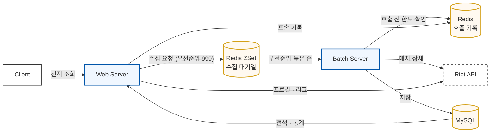

# TFT.GG : 전략적 팀 전투 전적 조회 서비스


## 프로젝트 개요

Riot Games API로 TFT 매치 데이터를 수집해 저장하고, 전적·누적 통계·LP 추이·랭킹을 보여주는 서비스입니다.

3인 팀으로 만든 첫 버전은 검색할 때마다 Riot API를 호출했습니다. 호출 제한에 걸리면 화면이 멈췄고, 데이터를 쌓지 않아 누적 통계를 보여줄 수 없었습니다. 이 저장소는 그 뒤 혼자 다시 만든 버전으로, 수집과 조회를 분리하고 매치를 DB에 저장합니다.

- **개발 인원:** 1인 (재개발)
- **구성:** Web(조회) · Batch(수집) 두 애플리케이션, MySQL, Redis
- **다룬 문제:** 호출 제한이 있는 외부 API의 수집 제어, 전적 페이지 조회 쿼리 개선

---

## 사용 기술

- **Backend :** Java 17, Spring Boot, Spring Data JPA, Spring Scheduler
- **Database / Cache :** MySQL, Redis
- **Frontend :** Thymeleaf, JavaScript, HTML, CSS
- **External API :** Riot Games API (TFT)
- **실행 환경 :** Docker Compose

---

## 시스템 구조



- Web은 프로필 표시에 필요한 정보만 Riot API로 바로 조회하고, 매치 수집은 대기열에 등록만 합니다.
- Batch가 대기열에서 우선순위가 높은 작업부터 꺼내 수집합니다. 사용자가 검색한 계정(999)이 정기 수집 대상보다 먼저 처리됩니다.

---

## 주요 설계와 문제 해결

### 1. 호출 제한: 429를 받기 전에 막기

**문제.** Riot API는 키 하나에 2분당 100회(초당 20회)로 제한됩니다. 처음에는 수집 주기(2초)만으로 속도를 조절하고, 429를 받으면 `Retry-After`만큼 `Thread.sleep`으로 기다렸습니다. 이 방식에는 세 가지 문제가 있었습니다.

- 소환사 작업은 매치 목록을 100개씩 여러 번 연달아 조회합니다. 작업 사이 간격으로는 호출 수가 조절되지 않아 2분마다 429가 났습니다.
- Web과 Batch가 같은 키를 쓰는데 서로의 사용량을 알 수 없었습니다.
- 대기하는 동안 수집 스레드가 트랜잭션을 연 채 멈춰 DB 커넥션을 잡고 있었습니다.

**해결.**

- **사전 제한기** (`batch/.../ratelimit/RiotRateLimiter`): 호출 시각을 Redis ZSet에 기록해 최근 2분·1초 구간의 호출 수를 셉니다. 한도가 찼으면 호출하지 않습니다. Batch의 모든 Riot 호출은 `RestTemplate` 인터셉터 한 곳에서 이 제한기를 지납니다.
- **한도 공유**: Web도 자기 호출을 같은 키에 기록합니다(`web/.../ratelimit/RiotCallRecorder`). Batch는 2분 100회 중 80회까지만 쓰고, Web이 쓴 만큼 덜 씁니다. 카운터를 Redis에 둔 이유는 두 애플리케이션이 별도 프로세스라 메모리 안의 카운터로는 합산할 수 없기 때문입니다.
- **대기 대신 건너뛰기**: 그래도 429가 오면 Redis에 차단 시간만 기록하고 작업을 대기열에 되돌린 뒤 바로 반환합니다. 스케줄러는 차단 중이거나 한도가 찼으면 작업을 꺼내지 않습니다. 트랜잭션은 저장 단계에만 둡니다.

**결과.** 같은 대기열로 10분씩 수집 (2026-10-11, 소환사 작업 기준)

| 구성 | 429 발생 | API 호출 수 |
| --- | --- | --- |
| 1초 주기, 제한기 없음 | 5회 | 약 477회 |
| 2초 주기, 제한기 없음 | 5회 | 약 472회 |
| 1초 주기 + 제한기 | 0회 | 약 373회 |

호출 수가 줄어든 것은 2분 100회 중 20회를 Web 몫으로 남겼기 때문이며, `riot.rate-limit.batch-per-two-minutes`로 조절합니다.

### 2. 전적 페이지 조회 개선

**문제.** 화면에는 20경기만 보여주는데 한 사람의 전체 기록을 읽고 있었습니다. 기록을 모두 가져와 Java에서 정렬·필터한 뒤 20개를 골랐고, 그 과정에서 경기 정보가 건별로 지연 로딩되어 전적이 1건 쌓일 때마다 SQL이 1회씩 늘었습니다.

**해결.**

| 처리 | 변경 전 | 변경 후 |
| --- | --- | --- |
| 전적 목록 | 전체 조회 후 Java에서 정렬·필터·20개 선택 | DB에서 정렬·페이징, 경기 정보는 fetch join |
| 통계 | 전체 기록을 엔티티로 읽어 Java에서 계산 | `COUNT`·`AVG`·`SUM` 집계 쿼리 1회 |
| 참가자·유닛·특성 | 건별 지연 로딩 | `@BatchSize(100)`으로 묶어 IN 쿼리 |

참가자·유닛·특성을 한 번에 fetch join하지 않은 이유는 컬렉션을 여러 개 join하면 행이 곱으로 늘고 페이징이 메모리에서 일어나기 때문입니다.

**결과.** 전적 페이지 요청 1회 기준 (커밋 `f46b103` → `759ac7d`)

| 계정의 저장 전적 수 | SQL 실행 수 | 응답 시간 중앙값 |
| --- | --- | --- |
| 100건 | 449 → 12 | 419ms → 302ms |
| 316건 | 701 → 11 | 592ms → 286ms |
| 541건 | 890 → 12 | 671ms → 336ms |
| 1,000건 | 1,349 → 12 | 957ms → 375ms |

측정 조건: 로컬 MySQL(매치 16,381건, 참가 기록 130,047건), 워밍업 5회 후 15회 반복, Riot API 응답은 고정값으로 대체해 제외, SQL 수는 Hibernate Statistics.

### 3. 랭킹 · LP 추이

- Batch가 주기적으로 갱신한 LP 기록으로 상위 랭커 순위를 보여줍니다.
- LP 추이 그래프는 승급·강등 때 점수가 끊기지 않도록 티어를 반영해 보정한 값으로 그립니다.

---

## 알고 있는 한계

| 한계 | 개선 방향 |
| --- | --- |
| 대기열에서 꺼낸 작업을 처리하다 종료되면 그 작업은 사라짐 | 처리 중 목록을 따로 두고 완료 시 제거 |
| 429 외의 오류는 로그만 남기고 재시도하지 않음 | 재시도 횟수 제한, 실패 작업 보관 |
| 여러 번 호출하는 작업이 중간에 한도에 걸리면 처음부터 다시 조회 | 진행 위치를 저장해 이어서 처리 |
| `participant.pa_puuid`에 인덱스가 없어 조회가 전체 행을 훑음 | 인덱스 추가 후 재측정 |
| 전적 페이지 HTML이 약 4MB | 경기 상세는 펼칠 때 불러오도록 분리 |
| 로컬 Docker Compose로만 실행 | 클라우드 배포, 수집 로그 모니터링 |

---

## 실행 방법

### 1. 설정 파일

프로젝트 루트에 `.env`를 만듭니다.

```env
MYSQL_ROOT_PASSWORD=your_root_password
MYSQL_USER=your_db_user
MYSQL_PASSWORD=your_db_password
RIOT_API_KEY=your_riot_api_key
```

`web/src/main/resources/application.properties`와 `batch/src/main/resources/application.properties`는 Git에 올라가지 않으므로 직접 만들어야 합니다. 필요한 키는 `spring.datasource.*`, `spring.data.redis.*`, `riot.api.key`이며, Web은 캐시 유지 시간(`app.cache.ttl.account`, `app.cache.ttl.league`, `app.cache.ttl.summoner`)도 필요합니다.

### 2. 실행

```bash
docker-compose up -d --build
```

Web은 `http://localhost:8080`에서 열립니다.

---

## 테스트와 측정

호출 제한기 테스트 (Redis가 `localhost:6379`에서 실행 중이어야 합니다)

```bash
cd batch
./mvnw test -Dtest=RiotRateLimiterTest
```

전적 페이지 조회 성능 측정 (`tft_mysql` 컨테이너 실행 중, Git Bash)

```bash
bash docs/bench/run-bench.sh
```

두 커밋의 Web 모듈을 임시 폴더에 꺼내 같은 DB에 연결하고, 전적 페이지를 반복 요청해 SQL 실행 수와 응답 시간을 출력합니다. Riot API 응답만 고정값으로 대체하며 DB는 변경하지 않습니다.
